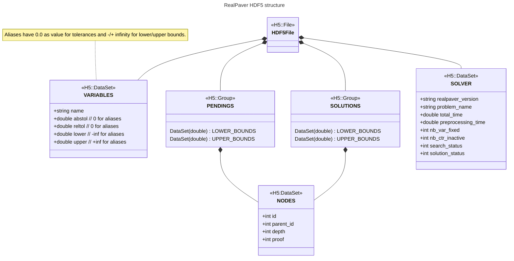

# Output file formats

Several output formats are supported to allow post-processing in external tools:

## SOL format

This is the default output format. It is a textual format with the following structure:

- a header specifying the RealPaver version, the input model and the date of generation
- a preprocessor section, summarizing its result (number of variables fixed, number of inactive constraints detected, etc.)
- a solving section, with several parts:
    - a brief summary of the solving process (time, number nodes, number of solutions found, etc.)
    - the list of solutions described using the box reporter, while specifiying their global width and their status:
        - `unvalidated`: no proof of an existing solution in the box
        - `exact`: proof of inner box (continuum of solutions)
        - `feasible`: proof of a unique solution in the box
    - the hull of remaining pending boxes
- a section describing the exhaustive list of used parameters with their value

## HDF5 format

Hierarchical Data Format version 5 is a generic file format to efficiently store and manage heterogeneous data. It supports n-dimensional datasets and each element in the dataset may itself be a complex object as well as a numerical value.

RealPaver is able to export `Solver` and `Space` objects with the following structure:

Then a generated HDF5 file with RealPaver is always composed of a DataSet at the root of the file to describe the variables and and aliases of the processed problem. If a `Solver` object is export, then a DataSet at the root of the file describes the solving process details. Depending of the exported `Space` object (nested in a solver or not), 2 groups may be defined to store the computed solutions and the pending nodes. In both cases, each node details are stored as well as the lower and upper bounds for each variable and for each alias.

These generated files can be easily handled by the HDF5 library in C language, in Python language or even in some tools able to load such files.

## CSV format

Coming soon...
